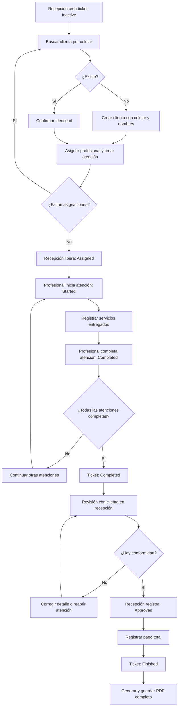
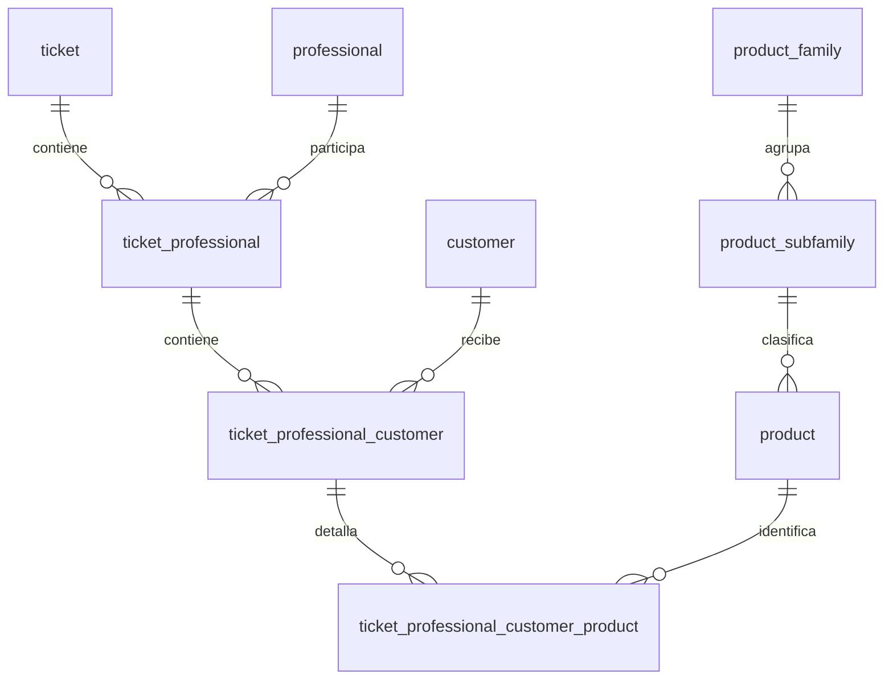

# Aplicación web de tickets — Lindas y Lunáticas

Versión: 1.0 · Fecha: 17 de octubre de 2026

## 1. Objetivo y alcance

Construir una aplicación web que permita a recepción crear y liberar tickets, asignar profesionales y clientas, registrar los servicios entregados, recibir la conformidad de las clientas, recaudar y generar un PDF del ticket completo.

Este documento consolida los acuerdos funcionales y las estructuras SQL trabajadas. No es un levantamiento directo de la base de datos. El desarrollador debe obtener el DDL vigente antes de implementar migraciones. Se distingue entre acuerdos, estructuras reportadas como creadas y propuestas pendientes.

### Estado de implementación conocido

- El usuario informó que las tablas del ticket fueron creadas.
- Se entregaron funciones y triggers para fechas de modificación; su instalación y funcionamiento deben comprobarse.
- Una consulta de 13 validaciones devolvió cero errores en relaciones, duplicados, precios y estados. No se comprobó si había datos; esto no constituye una prueba del proceso completo.
- No se han implementado en los scripts entregados las transiciones controladas, la propagación de estados ni el estado calculado por profesional.
- Pagos, auditoría completa, conformidad por clienta y gestión del PDF necesitan diseño físico e implementación.

## 2. Actores

| Actor | Responsabilidades |
|---|---|
| Recepción | Crear ticket, identificar o crear clientas, asignar profesionales, liberar, revisar con la clienta, registrar conformidad y pago. |
| Profesional | Iniciar y completar sus atenciones; registrar los servicios entregados. |
| Sistema | Generar identificadores y fechas, validar relaciones y permisos, calcular resúmenes y totalizar, generar PDF. |

La autenticación se apoya en `core."user"`. La vinculación entre usuario autenticado y profesional todavía debe definirse: no asumir que sus ID coinciden. El acceso de recepción a una organización también debe estar autorizado explícitamente.

## 3. Conceptos e invariantes

1. Un ticket es un contenedor único: se crea una vez y no se reutiliza.
2. La profesional opera sobre una atención: **Ticket + Profesional + Clienta**.
3. Cada atención contiene uno o más servicios al completarse; la exigencia de al menos un servicio es una regla propuesta para validar.
4. Una clienta puede recibir servicios de varias profesionales en el mismo ticket.
5. Una profesional puede atender a varias clientas en el mismo ticket.
6. Los servicios son líneas de detalle; no poseen un ciclo de estados propio.
7. El estado Ticket + Profesional es un resumen automático, no manipulable.
8. La conformidad y el cierre por pago se registran exclusivamente a nivel de ticket.
9. Nombre y precios aplicados se conservan en el detalle aunque después cambie el catálogo.
10. El número del ticket se muestra con un mínimo de seis dígitos: `000001`. No reinicia por mes ni por año. No debe truncarse cuando supere seis dígitos.
11. El generador usa una secuencia/IDENTITY, nunca `MAX(id) + 1` en la operación normal. Se aceptan saltos. No reiniciar ni reciclar números.

## 4. Flujo principal



Las atenciones de distintas profesionales pueden avanzar en paralelo. La corrección que exige continuar un servicio debe volver a la atención, pasar por Started y completarse nuevamente; no basta con regresar directamente a la revisión del diagrama.

## 5. Estados y reglas por nivel

### 5.1 Ticket

| Estado | Significado | Disparador |
|---|---|---|
| Inactive | Recepción prepara el ticket. | Creación. |
| Assigned | Ticket liberado, sin atenciones iniciadas. | Liberación por recepción. |
| Started | Hay avance operativo, pero faltan atenciones por completar. | Inicio de la primera atención. |
| Completed | Todas las atenciones terminaron. | Cierre de la última atención. |
| Approved | Recepción registró la conformidad de la clienta con detalle y total. | Acción de recepción. |
| Finished | Se registró el pago total y se cerró el ticket. | Acción de cobro validada. |

Secuencia principal: `Inactive → Assigned → Started → Completed → Approved → Finished`.

Regla para el resumen operativo del ticket:

- **Assigned → Started:** sigue siendo propuesta, no implementada. Hoy este cambio lo hace manualmente recepción al liberar el ticket; no hay recálculo automático al iniciarse la primera atención.
- **Started → Completed: confirmada e implementada.** Al completarse la atención que deja a todas las profesionales asignadas con todas sus atenciones en Completed, el ticket pasa automáticamente de Started a Completed, en la misma transacción que completa esa atención (`complete_ticket_professional_customer`, `services/ticket_professional_service.py`). Nunca completa un ticket sin profesionales asignados, ni uno donde algún profesional tenga aún atenciones pendientes. Approved y Finished no se ven afectados: la transición automática solo aplica cuando el ticket está en Started.

### 5.2 Ticket + Profesional

Después de la liberación:

- Completed: existe al menos una atención para esa asignación y todas están Completed.
- Assigned: cualquier otra condición, incluidas atenciones Started o ausencia de clientas.
- No existe Started en este resumen.
- Antes de liberar, la asignación es un borrador y no está disponible para atención. Puede presentarse como Inactive derivado del ticket; no es una tercera opción operativa manipulable.

Si se autoriza agregar una atención pendiente a una asignación completada, el resumen vuelve a Assigned. Esta incorporación debe bloquearse una vez aprobado o cerrado el ticket.

### 5.3 Ticket + Profesional + Clienta

| Transición | Responsable | Condición |
|---|---|---|
| Creación → Inactive | Recepción | Ticket en preparación. |
| Inactive → Assigned | Recepción/sistema | Liberación de asignaciones. |
| Assigned → Started | Profesional asignada | Inicio efectivo de atención. |
| Started → Completed | Profesional asignada | Confirma el detalle de lo realizado. |

Solo en Started se permite a la profesional agregar o corregir servicios. Para modificar después de Completed, proponer reapertura explícita con motivo y auditoría. La política final de reapertura debe confirmarse.

### 5.4 Línea de producto o servicio

No tiene columna de estado propia. Se consulta el estado de la atención padre y, si es necesario, aprobación/pago del ticket. Registrar la línea no significa ejecutar otra transición de estado.

## 6. Fechas y trazabilidad

Usar `TIMESTAMPTZ` para eventos. Guardar por separado la zona del salón; para esta instalación, `America/Santiago`. No fijar UTC−3 como regla permanente. Mostrar pantalla y PDF en la zona del salón.

| Campo | Regla |
|---|---|
| created_at, con prefijo de tabla | DEFAULT CURRENT_TIMESTAMP al insertar; no sobrescribir después. |
| updated_at, con prefijo | Actualización automática al modificar ese registro. |
| status_changed_at, con prefijo | Cambia únicamente al cambiar el estado efectivo. |

`CURRENT_TIMESTAMP` corresponde al inicio de la transacción. Si una transacción pudiera durar mucho y se necesita la hora exacta de ejecución del evento, acordar el uso de `clock_timestamp()`.

La modificación de un hijo no cambia por sí sola updated_at del padre: la propagación debe programarse explícitamente cuando corresponda. La fecha del estado calculado por profesional necesita lógica automática; no se obtiene solamente con una vista.

Las fechas de la última modificación no conservan todos los eventos. Se propone una tabla de historial que registre nivel, registro, estado anterior/nuevo, instante, usuario y motivo. Esto permitirá recuperar inicio, término, liberación, reaperturas, aprobación y cierre sin perder eventos anteriores.

## 7. Modelo relacional



### 7.1 Maestros y ubicación

| Tabla | Clave y notas |
|---|---|
| core.organization | organization_id INTEGER. Organización del salón: 2. |
| core.business | business_id INTEGER IDENTITY. KIVOR = 1; Lindas y Lunáticas = 2. |
| core.professional | professional_id INTEGER IDENTITY; business_id INTEGER; nickname y nombre; organization_id y professional_created_at agregados mediante migración propuesta/ejecutada, verificar DDL vigente. |
| core."user" | user_id INTEGER IDENTITY; credenciales con hash, nombre, activo, fecha, grupo. |
| lindasylunaticas.customer | customer_id INTEGER IDENTITY tras migración; celular, nombres, organización y otros datos del maestro. |
| lindasylunaticas.product_family | Familia, activo, fecha, organización y sort. |
| lindasylunaticas.product_subfamily | Subfamilia, familia, activo, fecha y sort. |
| lindasylunaticas.product | Código, nombre, tipo, precios, subfamilia, activo, fechas y sort. |

business_id y organization_id son conceptos distintos aunque en esta instalación ambos valgan 2. No compararlos ni intercambiarlos como si fueran una misma clave.

### 7.2 Ticket — lindasylunaticas.ticket

| Campo | Tipo | Regla |
|---|---|---|
| ticket_id | BIGINT IDENTITY | PK; generación única. |
| organization_id | INTEGER | NOT NULL; DEFAULT 2; FK core.organization. |
| ticket_status | VARCHAR(10) | NOT NULL; DEFAULT Inactive; CHECK de los seis estados. |
| ticket_created_at | TIMESTAMPTZ | NOT NULL; automático. |
| ticket_updated_at | TIMESTAMPTZ | NOT NULL; automático. |
| ticket_status_changed_at | TIMESTAMPTZ | NOT NULL; automático al cambio de estado. |

### 7.3 Asignación — lindasylunaticas.ticket_professional

| Campo | Tipo | Regla |
|---|---|---|
| ticket_professional_id | INTEGER IDENTITY | PK. |
| ticket_id | BIGINT | FK al ticket. |
| professional_id | INTEGER | FK a **core.professional**, no al esquema lindasylunaticas. |
| ticket_professional_created_at | TIMESTAMPTZ | NOT NULL; automático. |
| ticket_professional_updated_at | TIMESTAMPTZ | NOT NULL; automático. |
| ticket_professional_status_changed_at | TIMESTAMPTZ | NULL durante borrador; llenar al liberar y cambiar resumen. |

UNIQUE(ticket_id, professional_id). La estructura entregada **no tiene columna de estado**: exponerlo mediante vista/consulta. Para registrar sus transiciones, proponer una función que compare el resumen anterior y posterior bajo bloqueo, actualice la fecha y agregue historial. Evitar que el usuario edite esta fecha.

### 7.4 Atención — lindasylunaticas.ticket_professional_customer

| Campo | Tipo | Regla |
|---|---|---|
| ticket_professional_customer_id | INTEGER IDENTITY | PK. |
| ticket_professional_id | INTEGER | FK a asignación. |
| customer_id | INTEGER | FK a customer. |
| ticket_professional_customer_status | VARCHAR(10) | NOT NULL; DEFAULT Inactive; CHECK de cuatro estados. |
| ticket_professional_customer_created_at | TIMESTAMPTZ | NOT NULL; automático. |
| ticket_professional_customer_updated_at | TIMESTAMPTZ | NOT NULL; automático. |
| ticket_professional_customer_status_changed_at | TIMESTAMPTZ | NOT NULL; automático. |

UNIQUE(ticket_professional_id, customer_id). Estas claves representan la combinación Ticket + Profesional + Clienta sin repetir ticket_id.

### 7.5 Detalle — lindasylunaticas.ticket_professional_customer_product

| Campo | Tipo | Regla |
|---|---|---|
| ticket_professional_customer_product_id | INTEGER IDENTITY | PK de línea. |
| ticket_professional_customer_id | INTEGER | FK a atención. |
| product_id | INTEGER | FK a catálogo. |
| product_name | VARCHAR(250) | Copia histórica del nombre. |
| quantity | NUMERIC(10,2) | NOT NULL; DEFAULT 1; mayor que cero. |
| unit_price | NUMERIC(12,2) | Precio lista unitario aplicado, no negativo. |
| professional_unit_price | NUMERIC(12,2) | Base profesional unitaria aplicada, no negativa. |
| ticket_professional_customer_product_created_at | TIMESTAMPTZ | NOT NULL; automático. |
| ticket_professional_customer_product_updated_at | TIMESTAMPTZ | NOT NULL; automático. |

Los campos de detalle anteriores son NOT NULL. Repetir product_id en líneas distintas está permitido por el diseño; la interfaz debe advertir duplicación accidental. Subtotal de línea = quantity × unit_price. La base profesional no es un descuento al cobro de la clienta ni equivale por sí sola a comisión.

Índices previstos: FKs no cubiertas como primer campo por PK/UNIQUE, especialmente professional_id, customer_id, atención del detalle y product_id. No usar eliminación en cascada para borrar historia de tickets.

## 8. Catálogo, importación y precios

- Jerarquía: familia → subfamilia → producto vendible.
- En el Excel, FAMILIA y NIVEL_2 clasifican; NIVEL_3 y NIVEL_4 completan la descripción/variante.
- Cada combinación con precio propio tiene product_id distinto.
- Orden: familia.sort, subfamilia.sort, product.sort; agregar ID como desempate.
- Precio lista del Excel → product_price; precio profesional → product_professional_price.
- Se preparó una carga de 451 registros con códigos técnicos PRD000001..PRD000451. Su ejecución no se confirmó en esta conversación.
- Otras 15 filas tienen precio profesional negativo y precio lista vacío; no se incluyeron. Resolverlas como descuentos/ajustes antes de incorporarlas; no cambiar importes a cero para sortear restricciones.
- Duración y porcentaje profesional del Excel no tienen columnas en el product actual. Comisiones y agenda quedan fuera de esta primera estructura.
- La familia Abono perdido se añadió como concepto de ingreso por inasistencia; su subfamilia/producto y aplicación de abonos están pendientes.

## 9. Operaciones de aplicación y transacciones

### Crear y liberar

1. Recepción solicita nuevo ticket; backend inserta y devuelve ID con RETURNING.
2. Buscar clienta por celular, confirmar identidad y crear maestro si no existe.
3. Agregar profesional del maestro y atención, sin duplicar combinaciones.
4. Liberar ticket y sus atenciones en una transacción. Propuesta: exigir al menos una atención y ninguna asignación profesional vacía.
5. La profesional solo ve asignaciones liberadas que le correspondan.

### Atender

1. Bloquear o verificar versión de atención y ticket; validar usuario asignado y estado Assigned.
2. Cambiar atención a Started; guardar evento y recalcular ticket.
3. Agregar productos activos autorizados para la organización; copiar nombre y precios desde servidor, no confiar en precios del navegador.
4. Completar atención; validar detalle y recalcular resumen por profesional/ticket en la misma transacción.

### Aprobar y cobrar

1. Recepción abre un ticket Completed y presenta detalle por clienta/profesional, importes y total.
2. Registrar conformidad y pasar a Approved. Congelar detalle aprobado; corrección posterior exige invalidar aprobación con trazabilidad.
3. Registrar pago confirmado y cierre de manera atómica; nunca marcar Finished solo por pulsar un botón sin pago válido.
4. Solicitar generación de PDF después del cierre confirmado.

### Concurrencia y seguridad propuestas

- Acciones de negocio en backend/funciones, con comprobación de estado anterior; no exponer UPDATE arbitrario de estados.
- Bloquear ticket primero y luego asignación/atención en orden consistente para serializar cambios del mismo ticket y evitar resúmenes contradictorios.
- Usar transacciones cortas; no mantenerlas abiertas mientras la clienta revisa o mientras se genera PDF.
- Idempotencia para doble clic, reintentos de creación y especialmente pagos. Las secuencias evitan IDs repetidos, pero no evitan dos tickets creados por el mismo reintento.
- Verificar organización del ticket, profesional, clienta y producto mediante sus relaciones. Las FK simples actuales no garantizan igualdad de organización.
- Consultas parametrizadas; permisos por rol; solo la profesional asignada modifica su atención.
- No aceptar created_at, updated_at o status_changed_at arbitrarios desde el navegador.

## 10. Componentes pendientes para completar el proceso

Estas son propuestas de implementación, no tablas existentes confirmadas.

| Componente | Datos mínimos propuestos | Regla |
|---|---|---|
| Historial de estados | Nivel, ID del registro, estado anterior/nuevo, fecha, user_id, motivo. | Insertar eventos con la operación; no sobrescribir. |
| Pagos del ticket | ID, ticket_id, importe, moneda, medio, estado, fecha, usuario, referencia e idempotencia. | Solo pagos confirmados cuentan para saldo. |
| Conformidad | Ticket, usuario recepción, fecha, observación y versión/total aceptado. | La aceptación se registra en nombre de la clienta; no afirmar firma digital. |
| Documentos | Ticket, tipo, ubicación privada, fecha, estado generación, versión y error. | Permitir reintento sin volver a cobrar. |

No se ha acordado todavía pago parcial, varios medios, devoluciones, descuentos, propinas ni anulación. Si se admiten pagos parciales, Finished requiere saldo cero; mientras falte saldo permanece Approved bajo la propuesta inicial.

Un abono recibido anteriormente debe aplicarse al ticket o concepto correspondiente sin registrar una segunda entrada de dinero. El tratamiento contable/tributario y los documentos fiscales requieren definición independiente; el PDF operativo no se presume boleta o factura.

## 11. PDF al finalizar

Contenido acordado/propuesto: identificación del salón y ticket, estado Finished, fecha de creación/cierre, clientas, profesionales, atenciones e hitos, servicios, cantidades, precios, subtotales, descuentos si se implementan, total y pagos con saldo final.

Generarlo con los valores históricos del cierre. Conservar una copia asociada al ticket y permitir descarga/impresión con permisos. Si falla la generación, mantener el pago y Finished; marcar documento pendiente/error y reintentar. No regenerar con precios vigentes del catálogo. El PDF no debe exponerse mediante una URL pública que revele datos de clientas.

## 12. Pantallas mínimas

| Pantalla | Funciones |
|---|---|
| Recepción — listado | Ticket, creación, estado, profesionales, clientas, total; filtros de fecha/estado. |
| Recepción — preparación | Nuevo ticket, búsqueda/alta de clienta, asignaciones, liberar. |
| Profesional — mis atenciones | Listado por ticket/clienta; iniciar, agregar servicios, completar. |
| Recepción — revisión y caja | Detalle completo, conformidad, pago y cierre. |
| Ticket histórico | Detalle y eventos, pagos y PDF según permisos. |

En listados de profesional mostrar Assigned incluso si una atención está Started: ese resumen solo finaliza cuando todas sus atenciones están Completed. Mostrar los estados individuales de clientas para conocer el avance real.

## 13. Consulta base para seguimiento

```sql
SELECT
    t.ticket_id,
    t.ticket_status,
    p.professional_id,
    p.professional_nickname,
    a.customer_id,
    c.customer_full_name,
    a.ticket_professional_customer_status AS attention_status,
    d.product_id,
    d.product_name,
    d.quantity,
    d.unit_price,
    d.quantity * d.unit_price AS line_total
FROM lindasylunaticas.ticket t
LEFT JOIN lindasylunaticas.ticket_professional tp
    ON tp.ticket_id = t.ticket_id
LEFT JOIN core.professional p
    ON p.professional_id = tp.professional_id
LEFT JOIN lindasylunaticas.ticket_professional_customer a
    ON a.ticket_professional_id = tp.ticket_professional_id
LEFT JOIN lindasylunaticas.customer c
    ON c.customer_id = a.customer_id
LEFT JOIN lindasylunaticas.ticket_professional_customer_product d
    ON d.ticket_professional_customer_id =
       a.ticket_professional_customer_id
WHERE t.organization_id = 2
ORDER BY t.ticket_id, tp.ticket_professional_id,
         a.ticket_professional_customer_id,
         d.ticket_professional_customer_product_id;
```

Para totalizar, sumar líneas de detalle antes de unir pagos: unir directamente varias líneas con varios pagos multiplica filas e infla totales. customer_full_name puede estar vacío; acordar fallback desde campos de nombres.

## 14. Criterios de aceptación

1. Crear dos tickets simultáneamente produce números distintos y fechas automáticas.
2. Reintentar una misma solicitud idempotente no crea otro ticket ni otro pago.
3. Buscar clienta existente no crea duplicado; si hay varias coincidencias por celular se solicita selección.
4. No se repite ticket/profesional ni asignación/clienta; una clienta sí puede estar con dos profesionales.
5. La profesional no puede iniciar una atención Inactive ni otra que no le pertenezca.
6. Agregar un servicio en Started conserva nombre y precios aplicados.
7. Completar una atención no completa las demás.
8. Profesional con una atención Completed y otra Started mantiene resumen Assigned.
9. Todas las atenciones de una profesional Completed producen resumen Completed y fecha de transición automática.
10. No completar automáticamente una asignación o ticket sin atenciones.
11. La última atención completa produce ticket Completed; no Approved ni Finished.
12. Solo recepción registra Approved y posteriormente el cobro total.
13. Cambiar un dato sin cambiar estado modifica updated_at, pero no status_changed_at.
14. Cambiar precios del catálogo no altera el histórico del ticket.
15. Falla de PDF permite reintentar conservando pago y cierre único.
16. Accesos y relaciones entre organizaciones distintas se rechazan.
17. Las FK apuntan a core.professional y los tipos de ID coinciden.
18. Probar atenciones simultáneas de dos profesionales y verificar consistencia del resumen.

## 15. Decisiones que deben cerrarse antes de implementar caja

- Conformidad de varias clientas: ¿conjunta o individual antes de aprobar todo el ticket? Mantener una sola aprobación del ticket hasta acordar el detalle.
- Celular: normalización internacional y posibilidad de compartir número entre clientas. Usar customer_id como identidad permanente.
- Política de reapertura, cancelación, abandono y tickets sin atención. No introducir estados nuevos sin acuerdo.
- Moneda, inclusión de impuestos, redondeo, descuentos y comprobante fiscal.
- Pagos parciales, abonos, medios combinados y devoluciones.
- Permisos para modificar precio y quién puede invalidar una aprobación.
- Venta de producto físico sin atención: el modelo actual exige una profesional y una clienta; definir si esa regla también aplica a ventas de recepción y Abono perdido.
- Usuario responsable en creación, liberación, cambio de estado, aprobación y pago: requiere campos o historial adicionales a las tablas actuales.

## 16. Orden recomendado de implementación

1. Obtener DDL vigente, índices, constraints y triggers; reconciliar con este documento mediante migraciones versionadas.
2. Implementar autenticación, relación usuario/profesional y control por organización.
3. Implementar preparación y liberación del ticket, búsqueda/alta de clientas.
4. Implementar atenciones y detalle con precios históricos.
5. Implementar reglas transaccionales de estados, resumen e historial.
6. Resolver decisiones de caja; implementar conformidad, pagos y cierre.
7. Implementar PDF persistente con reintentos.
8. Ejecutar pruebas de aceptación con datos de prueba, incluyendo concurrencia y fallas.

### Fuentes de esta especificación

- Acuerdos y SQL compartidos en esta conversación, 16–17 de octubre de 2026.
- Producto.xlsx, Hoja1: 466 registros; 8 familias y 41 subfamilias identificadas.
- Resultados aportados por el usuario: negocios 1 y 2, 17 profesionales del negocio 2 y 13 comprobaciones de consistencia sin errores.

Este documento es la base funcional y técnica para desarrollo. Los puntos marcados como propuestas o pendientes no deben presentarse como decisiones ya aprobadas ni funcionalidades ya implementadas.
